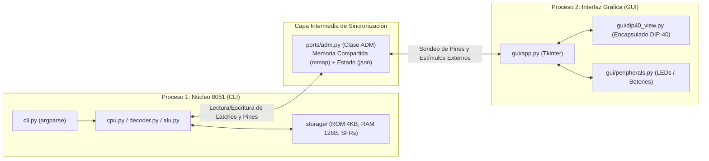

# Emulador Atmel/Microchip AT89S51 (Arquitectura 8051) en Python

Emulador modular del microcontrolador de 8 bits **Atmel/Microchip AT89S51** (familia MCS-51) implementado en Python puro, diseñado bajo una arquitectura desacoplada en capas para ejecución y depuración en **Visual Studio Code**.

---

## 1. Arquitectura Harvard del AT89S51

El AT89S51 implementa una **arquitectura Harvard** con espacios de direcciones físicamente separados para la memoria de programa (código) y la memoria de datos:

* **Memoria de Programa (Flash ROM interna):**
  * Capacidad de **4 KB** (`4096 bytes`), mapeada desde `0x0000` hasta `0x0FFF`.
  * Almacena el firmware cargado desde archivos en formato **Intel HEX** (`.hex`).
* **Memoria de Datos Interna (RAM):**
  * Capacidad de **128 bytes** (`0x00` a `0x7F`), estructurada en tres regiones:
    * `0x00` – `0x1F`: **4 bancos de registros** (`Bank 0` a `Bank 3`), cada uno con 8 registros de propósito general (`R0`–`R7`).
    * `0x20` – `0x2F`: **16 bytes direccionables bit a bit** (128 bits individuales con direcciones `0x00`–`0x7F`).
    * `0x30` – `0x7F`: **RAM de propósito general** y espacio de crecimiento ascendente de la pila (*Stack*).
* **Registros Principales y SFRs (*Special Function Registers*, `0x80` – `0xFF`):**
  * **`A` (`ACC`, `0xE0`):** Acumulador principal de 8 bits para operaciones de la ALU y transferencias de datos.
  * **`B` (`0xF0`):** Registro auxiliar de 8 bits empleado en instrucciones de multiplicación (`MUL AB`) y división (`DIV AB`).
  * **`PSW` (`0xD0`):** Palabra de estado del programa (*Program Status Word*), contiene las banderas `CY` (Carry), `AC` (Auxiliary Carry), `F0`, selector de banco `RS1:RS0`, `OV` (Overflow) y `P` (Paridad).
  * **`SP` (`0x81`):** Puntero de pila de 8 bits (inicializado en `0x07` tras un reset).
  * **`DPTR` (`DPL` en `0x82`, `DPH` en `0x83`):** Registro puntero de datos de 16 bits para direccionamiento indirecto de memoria externa o tablas en ROM (`MOVC`).
  * **`PC` (16 bits):** Contador de programa (*Program Counter*), direcciona hasta 64 KB (`0x0000`–`0xFFFF`) y apunta a la siguiente instrucción a decodificar.
* **Puertos Bidireccionales de E/S de 8 bits:**
  * **`P0` (`0x80`):** Puerto 0 de 8 bits (drenador abierto en modo E/S; bus multiplexado de direcciones/datos bajos `AD0`–`AD7` en acceso externo).
  * **`P1` (`0x90`):** Puerto 1 de 8 bits con resistencias *pull-up* internas (E/S de propósito general y líneas de programación ISP).
  * **`P2` (`0xA0`):** Puerto 2 de 8 bits con *pull-up* internas (E/S o byte alto de direcciones `A8`–`A15`).
  * **`P3` (`0xB0`):** Puerto 3 de 8 bits con *pull-up* internas y funciones alternativas (`RXD`, `TXD`, `INT0`, `INT1`, `T0`, `T1`, `WR`, `RD`).

---

## 2. Arquitectura del Software y Desacoplamiento Estricto

El sistema prohíbe cualquier importación o llamada directa entre el **Núcleo 8051 (`src/core`)** y la **Interfaz Gráfica (`src/gui`)**. Ambos subsistemas operan como procesos independientes sincronizados exclusivamente mediante la **Capa ADM (`src/ports`)**:



### Reglas de Aislamiento
1. **Cero acoplamiento directo:** `src/core` nunca importa `tkinter` ni módulos de `src/gui`; `src/gui` nunca importa `CPU8051`, `ProgramROM`, `InternalRAM` ni `SpecialFunctionRegisters`.
2. **Contrato único en `ADM`:** Toda transferencia de estado de los puertos `P0`–`P3` y señales de control (`RST`, `XTAL`, `ALE`, `PSEN`, `EA`) pasa por la clase `ADM` respaldada por `mmap` y `json`.
3. **Ejecución autónoma:** El núcleo puede correr en modo *headless* desde terminal o integrarse en pipelines de pruebas automatizadas sin abrir ventanas gráficas.

---

## 3. Instalación y Ejecución en Visual Studio Code

### Requisitos Previos
* **Python 3.10** o superior.
* Soporte para **Tkinter** instalado en el sistema operativo (incluido por defecto en Windows; en distribuciones basadas en Debian/Ubuntu/Linux Mint instalar mediante `sudo apt install python3-tk`).
* **Visual Studio Code** con la extensión oficial de **Python** (`ms-python.python`).

### Configuración del Entorno
1. Clonar el repositorio y abrir la carpeta en VS Code:
   ```bash
   git clone <URL_DEL_REPOSITORIO>
   cd at89s51-emulator
   code .
   ```
2. Crear y activar el entorno virtual (`.venv`):
   * **Linux / macOS:**
     ```bash
     python3 -m venv .venv
     source .venv/bin/activate
     ```
   * **Windows (PowerShell):**
     ```powershell
     python -m venv .venv
     .\.venv\Scripts\Activate.ps1
     ```
3. Seleccionar el intérprete `.venv` en VS Code (`Ctrl + Shift + P` -> `Python: Select Interpreter`) e instalar `pytest`:
   ```bash
   pip install -r requirements.txt
   ```

### Ejecución Desacoplada (Dos Terminales en VS Code)
* **Terminal 1 — Iniciar el Núcleo 8051 (CLI):**
  ```bash
  python -m src.core.cli --hex firmware_examples/blink_p1.hex
  ```
* **Terminal 2 — Iniciar la Interfaz Gráfica DIP-40 (GUI):**
  ```bash
  python -m src.gui.app
  ```

### Ejecución de Pruebas con `pytest`
```bash
pytest -v
```